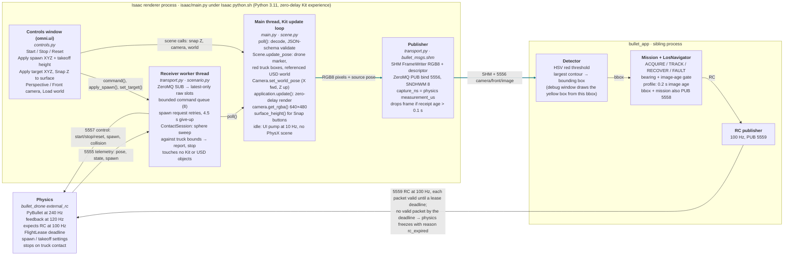

# Isaac Renderer Map

`bullet_render · isaac/`

How the Isaac Sim 5.0 renderer in bullet_render sits between physics and the app.
Physics owns dynamics and the RC lease. The renderer only receives poses, draws the
world and publishes the front-camera image. The app closes the loop with RC commands
that never pass through the renderer.

A browser version with the same content is in
[isaac-renderer-map.html](isaac-renderer-map.html).

## Processes, threads and what moves between them



The receiver thread owns the sockets and copies bounded raw messages into latest-only
slots. The main Kit thread validates them, moves the scene and camera, renders and
publishes. The thick teal edges mark the image path, the only hop whose latency the RC
lease pays for. Inside bullet_app the image goes to the detector, its bounding box to
the mission, and the mission's RC command to physics. The RC return path bypasses the
renderer entirely.

## Where a frame's time goes

During an approach the app caps each RC packet's validity at the frame's capture time
plus the profile's image-age bound. Render time therefore eats directly into the lease
margin. Measured on Rivermark with the app debug window open.

Timeline in milliseconds after the physics measurement. One character is 4 ms.

```text
ms                   0         20        40        60        80        100       120       140       160       180       200       220
                     |         |         |         |         |         |         |         |         |         |         |         |
Physics measurement  ●  capture_ns stamped here
Isaac render         ██████████████████████░░░░░░░░░░ 40 ms, one viewport; +20 ms with a second full-size viewport
Frame age at app                                   ┃59 median  ┃73 p90      (81 / 94 with second viewport)
Lease, Godot profile ━━━━━━━━━━━━━━━━━━━━━━━━━━━━━━━━━━━━━━━━━━━━━━━━━━━┫ capture + 0.1 s
Lease, Isaac profile ━━━━━━━━━━━━━━━━━━━━━━━━━━━━━━━━━━━━━━━━━━━━━━━━━━━━━━━━━━━━━━━━━━━━━━━━━━━━━━━━━━━━━━━━━━━━━━━━━━━━┫ capture + 0.2 s
```

| Event | Time after measurement | Note |
| --- | --- | --- |
| Physics measurement | 0 ms | `capture_ns` is stamped with the physics `measurement_us` |
| Isaac render done | about 40 ms | one viewport; a second full-size viewport adds about 20 ms |
| Frame received by the app | 59 ms median, 73 ms p90 | 81 / 94 ms with the second viewport |
| Lease expiry, Godot profile | 100 ms | capture + 0.1 s image-age bound |
| Lease expiry, Isaac profile | 200 ms | capture + 0.2 s image-age bound (`isaac/mission_profile.json`) |

One frame from measurement to lease expiry. With the 0.1 s bound a 59 ms image leaves
about 40 ms for detection, navigation and transport, and the replay check expires at
70 ms of camera delay. The Isaac profile's 0.2 s bound holds up to about 150 ms in
replay and expires near 190 ms.

## Modules

| File | Owns | Thread |
| --- | --- | --- |
| `isaac/main.py` | CLI, SimulationApp with the zero-delay experience, capture loop, startup spawn from the CLI or world preset, stats every 5 s. | main |
| `isaac/transport.py` | Receiver worker, Publisher, schema decode, pose to camera pose conversion. | worker + main |
| `isaac/scene.py` | USD stage, world reference with unit and up-axis conversion, empty instancer pruning, truck boxes, surface_height, viewport cameras, DroneMarker. | main |
| `isaac/controls.py` | omni.ui window, Apply and Snap actions, enable state while physics runs. | main |
| `isaac/scenario.py` | Truck bounds, sphere sweep, ContactSession completion. | worker |
| `isaac/surface.py` | Pure triangle math under a vertical line; unit tested. | any |
| `isaac/presets.py` | Loads the per-world preset without importing Isaac; unit tested. | any |
| `isaac/world_presets.json` | Default truck origin and, where needed, starting position per world file name. | config |
| `isaac/mission_profile.json` | Navigator profile for the app with a 0.2 s image-age bound. | config |

## Ports and topics

| Port | Direction for the renderer | Payload |
| --- | --- | --- |
| 5555 | SUB from physics | `render/drone_1/config`, `render/drone_1/pose`, `simulation/state`, spawn state |
| 5557 | send to physics | start, stop, reset, spawn request, collision report |
| 5556 | PUB bind, read by the app | `camera/front/image` descriptor; pixels in POSIX shared memory |
| 5558 | not used | app bbox, mission and LOS telemetry |
| 5559 | not used | RC from the app to physics |

Checks: `tests/test_isaac_*.py` run without Isaac. `tools/check_isaac_world.py`,
`check_isaac_renderer.py`, `check_isaac_scenario.py` and `check_isaac_flight.py` need
Isaac's python.sh and run on isolated ports through `tools/isaac_control_probe.py`.
